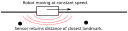
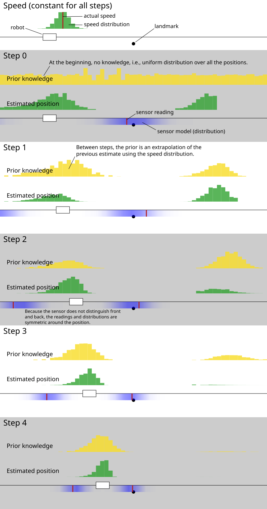

[](https://signaloid.io/repositories?connect=https://github.com/signaloid/Signaloid-Demo-Robotics-ParticleFilter#gh-dark-mode-only)
[](https://signaloid.io/repositories?connect=https://github.com/signaloid/Signaloid-Demo-Robotics-ParticleFilter#gh-light-mode-only)
# Particle Filter

This repository contains a 1D [Particle Filter](https://en.wikipedia.org/wiki/Particle_filter) implemented using Signaloid's distribution-enabled technology.

A particle filter is an algorithm to solve the [filtering, or state estimation, problem](https://en.wikipedia.org/wiki/Filtering_problem_%28stochastic_processes%29).
The goal is to estimate the state of an evolving system from sensor observations.
The challenges are that the system is usually not fully observable and the sensors are subject to noise.
Robot localization is an instance of the state estimation problem.

The robot localization problem corresponds to a robot trying to figure out its location in a known environment.
The robot does not have a sensor, such as a GPS, that directly give its location.
Instead, it is equipped with radars or cameras which give information about the surroundings.
Using this information and the knowledge of the environment, the robot tries to determine its location.

A particle filter approximates the distribution of the state using a collection of _particles_.
Each particle is a concrete state, e.g., a robot's position.
The motion of the robot is simulated on each particle and each particle is evaluated against the sensor observations.
In the evaluation, the particles that are more likely given the sensor readings get more weights.
The particles get resampled proportionally to the weights and the process repeats.


Signaloid's distribution-enabled processors help in two key aspects of the filter.
1. The particles are implicitly represented using the processor's native distributions.
2. Bayesian reasoning in [UxHw library](https://docs.signaloid.io/docs/hardware-api/) does the majority's of the filter's work, taking care of the comparison against the sensor readings and resampling.

## 1 degree of freedom robotic system with a distance sensor

The example is a 1 degree of freedom mobile robot.
This, for instance, can be a robot moving on a rail or a gantry.

The robot has a distance sensor that can detect nearby objects.
We call the objects that are detected _landmarks_ and we know their position.
The sensor returns the distance of the closest landmark but does not indicate if it is in front or behind the robot.

Here is a visual representation of the system.



The robot does not know its initial position and moves at a constant speed.
It does not know the exact speed, only the distribution from which the speed is drawn.
Furthermore, the measurements of the sensor are subject to additive Gaussian noise.


## Program output


Running this program on [signaloid.io](https://signaloid.io/) produces a textual output by default.
It is possible to produce an SVG image as well using the option `-g`.
The `-o` option writes the output distributions as CSV, as it does in the other demos.

Here an example output image with some annotation to explain all the elements.

First, we show the actual speed of the robot and the speed distribution used by the filter.
Then, we show each time step.



The output also shows the mode of distribution.
The mode is the maximum of the density.
This can be helpful when dealing with multimodal distributions.

## How Signaloid's technology helps

A particle filter keeps particles to approximate a distribution of the possible state.
As the Signaloid processor can natively track distributions, we do not need to explicitly track particles.
The processor takes care of all that for us.
For instance, in [`main.c`](src/main.c), the filter is initialized with
```c
estimatedPosition = UxHwFloatUniformDist(positionMin, positionMax);
```
This tells the processor that we have no information about the system and that every position is equally likely.

In addition, the Signaloid distribution representations are a powerful tool to concisely model the sensor.
In [`model.c`](src/model.c), the `sensorModel` function tells the processor that the sensor is subject to Gaussian noise with:
```c
distanceWithNoise = UxHwFloatGaussDist(distance, distance * sensorStdCoeff);
```
This creates a Gaussian distribution around the actual distance with a standard deviation that depends on the distance and a sensor-specific coefficient.

A key step of the algorithm is to update the distribution of the possible state with sensor readings.
Here, we offload the work to UxHw to perform Bayesian inferences so this step becomes an one-liner (in [`main.c`](src/main.c)):
```c
estimatedPosition = UxHwFloatBayesLaplace(
			&sensorModelEvidence,
			(void *)(&sensorModelArgs),
			estimatedPosition,
			sensorReading);
```
where
* `sensorModelEvidence` is a function that models the sensor.
* `sensorModelArgs` The rest of the arguments that `sensorModelEvidence` function requires.
* `estimatedPosition` is the variable with an associated distribution containing the state of the filter.
* `sensorReading` is the value returned by the sensor.


## Usage
```
Example: Particle Filter - Signaloid version

Usage: Valid command-line arguments are:
	[-i, --input <Path to the landmarks input file : str>] (Read landmarks from file.)
	[-o, --output <Path to output CSV file : str>] (Specify the output file.)
	[-S, --select-output <output : int (Default: 0)>] (Compute 0-indexed output. Calculate all possible outputs if equal to 1.)
	[-M, --multiple-executions <Number of executions : int (Default: 1)>] (Repeated execute kernel for benchmarking.)
	[-T, --time] (Timing mode: Times and prints the timing of the kernel execution.)
	[-j, --json] (Print output in JSON format.)
	[-h, --help] (Display this help message.)
	[-k, --max-number-of-steps <Maximum number of steps to execute : int> (Default: 5)]
	[-p, --position-min <Min position in X-axis : float> (Default: -10.000000)]
	[-P, --position-max <Max position in X-axis: float> (Default: 10.000000)]
	[-e, --expected-speed <The expected speed of the model: float> (Default: 1.000000)]
	[-s, --speed-standard-deviation <The standard deviaton of the speed of the model : float> (Default: 0.500000)]
	[-c, --sensor-coefficient <The standard deviaton coefficient of the speed of the model : float> (Default: 0.500000)]
	[-x, --true-position <The position the robot actually starts from : float> (Default: -4.500000)]
	[-y, --true-speed <The speed the robot actually moves at : float> (Default: 1.000000)]
	[-z, --sample-initial-state] (Draw the robot's initial position and speed instead of using the values above.)
	[-n, --sampled-readings] (Draw each sensor reading from the sensor model instead of using the noiseless distance.)
	[-g, --svg-output <Path to the SVG output file : str>] (Render the run as an SVG.)
```

When no landmark is given, by default the code places a landmark in the middle of the allowed positions.

## Reproducibility

By default a run is reproducible. The robot starts at `--true-position` moving at
`--true-speed`, and each step's sensor reading is the noiseless distance to the nearest
landmark. The filter still models the sensor's Gaussian noise in its Bayes-Laplace
update. Only the realized reading is noiseless.

Keep the robot off the landmarks. `sensorModel()` gives a reading the standard
deviation `distance * sensorStdCoeff`, so a reading taken at distance zero is a Dirac,
the Bayes-Laplace update has nothing to weigh, and the estimate comes back NaN. That is
why the default start is -4.5 rather than 0.0: the default landmark sits at 0.0, midway
between `--position-min` and `--position-max`, and a half-integer offset at the default
unit speed keeps every step clear of it.

The demo used to draw the robot's initial position and speed with `UxHwFloatSample()`
and each reading from the sensor model, so every run tracked a different realization
and no two runs, or two execution cores, could be compared with each other or against
a Monte Carlo reference. Pass `-z` and `-n` to get that behavior back.

## Structure

The demo follows the structure of the sensor conversion-routine demos, so that it fits
the same benchmarking infrastructure:

- `src/kernel.c` holds the filter kernel, `ParticleFilter_calculateOutput()`, which does
  no I/O and so also builds for targets with no operating system under them.
- `src/particle-filter-uxhw.c` and `src/particle-filter-monte-carlo.c` are the two
  execution-mode kernels.
- `src/model.c`, `src/system.c` and `src/environment.c` hold the filter's mathematics,
  unchanged.
- `src/main.c` parses the command line, dispatches to one of the two kernels, and prints
  the results.
- `make local-build` builds the native Monte Carlo executable, against the UxHw
  compatibility shim in `submodules/compat`.
  The native build uses gcc by default. Clang is also supported. To build with clang, run
  ```
  make local-build CC=clang
  ```

### Monte Carlo mode

The native build cannot run `UxHwFloatBayesLaplace()`, so `-M N` runs a classic particle
filter instead. It draws N particles from the same uniform prior the UxHw path uses and
moves them with the same motion model. Each step weighs every particle by the density of
the sensor model at the reading, in closed form, and resamples. This is the same
posterior the Bayes-Laplace rule computes. The N particles after the last step are the N
output samples. Because resampling copies particles, the samples are not fully
independent. The last move adds fresh noise to each. For the default run the native
result matches the UxHw one (mean 0.62, standard deviation 0.82 against 0.62 and 0.81).
`-M 1000000` takes a few seconds.
